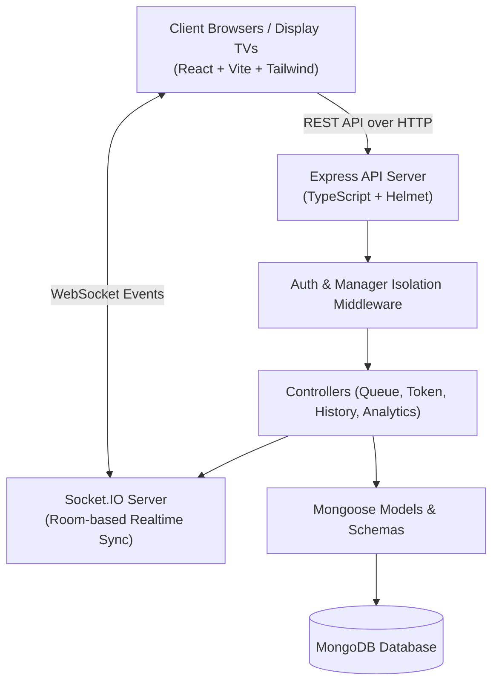
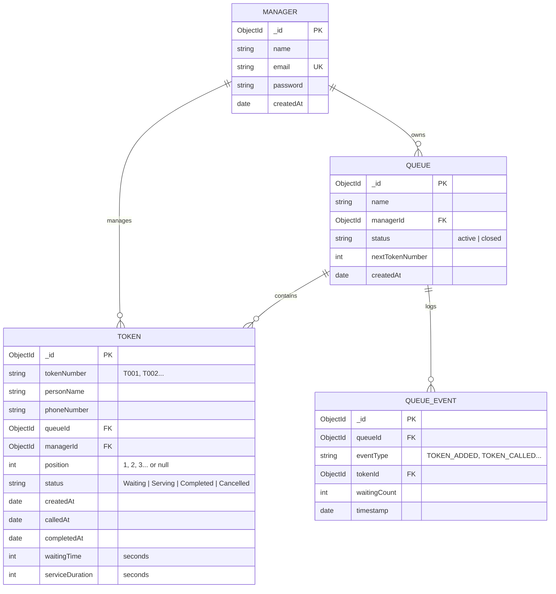

# QueueFlow – Smart Queue Management System

[](https://opensource.org/licenses/MIT)
[](https://www.typescriptlang.org/)
[](https://reactjs.org/)
[](https://nodejs.org/)
[](https://www.mongodb.com/)
[](https://tailwindcss.com/)
[](https://socket.io/)

**QueueFlow** is a modern, responsive, production-ready Full-Stack Queue Management System developed with **React, TypeScript, Vite, Tailwind CSS, Express, MongoDB, and Socket.IO**. Built for clinics, service counters, financial desks, and customer service centers, it provides real-time token tracking, atomic position reordering, live waiting room signage, and genuine database-driven operational telemetry.

---

## 🌟 Key Features

### 1. 🛡️ Secure Manager Authentication
- Full registration & login flow with **bcrypt** password hashing and **JWT** session tokens.
- Persistent session management with automated token expiry and renewal guards.
- **Strict Data Isolation**: Managers can exclusively view and manage their own queues and tokens.

### 2. 🗂️ Queue Management
- Create, rename, activate, close, and delete service queues.
- Real-time counter metrics: currently waiting count, served count, and next token number.
- Cascade deletion protection ensuring associated tokens and event snapshots remain clean.

### 3. 🎫 Intelligent Token Operations (Core Module)
- **Sequential Token Generation**: Automatic unique token numbers (`T001`, `T002`, `T003`...) scoped per queue.
- **Atomic Position Swapping**: Move waiting tickets **Up** or **Down** in priority with real-time positional index reconciliation.
- **Single-Server Guard ("Call Next")**: Strictly enforces that only **one customer can be in "Serving" status per queue at a time**.
- **Real Durations**: Computes accurate **Waiting Time** (`calledAt - createdAt`) and **Service Duration** (`completedAt - calledAt`).
- **Cancellation Flow**: Safely cancel waiting tokens with modal confirmation while dynamically advancing remaining queue positions.

### 4. 📺 Live Public Waiting Room Signage
- Dedicated public TV/monitor display (`/display/:id` or `/public/queue/:id`).
- High-contrast, billboard-sized "NOW SERVING" spotlight with audible notification chimes.
- "UP NEXT IN LINE" ticker without exposing sensitive customer phone numbers or manager credentials.
- Real-time updates via **Socket.IO** rooms — zero page reloads needed when a manager calls the next customer.

### 5. 📊 Real Database Telemetry & Analytics
- **No hardcoded stats or mock charts**: Computes metrics from actual MongoDB records and event logs.
- Interactive **Recharts**:
  - **Queue Length Fluctuations**: Historical depth chart recorded across state change events.
  - **Daily Token Volume**: Comparison between generated, completed, and cancelled tickets.
  - **Peak Hour Distribution**: 24-hour histogram identifying rush periods.
  - **Queue-Wise Performance**: Multi-counter comparison table with average wait times and cancellation rates.

### 6. 📜 Comprehensive Audit History & CSV Export
- Searchable and filterable history table (search by token number, person name, or phone number).
- Filter by status (`Waiting`, `Serving`, `Completed`, `Cancelled`), queue, and custom date ranges.
- Built-in **1-click CSV Export** for offline reporting and spreadsheet analysis.

### 7. 🎨 SaaS Design System & Accessibility
- Clean SaaS aesthetic: slate/white background with indigo accents.
- Responsive design for mobile, tablet, and desktop viewports.
- Full **Light and Dark mode** support with automatic system preference detection.
- Toast notifications and keyboard-accessible confirmation modals.

---

## 🏗️ Technology Stack

| Layer | Technologies |
|---|---|
| **Frontend** | React 18, TypeScript, Vite, Tailwind CSS, Lucide React, Recharts, React Router DOM 6, Axios, Socket.IO Client |
| **Backend** | Node.js, Express.js, TypeScript, Mongoose 8, JWT, bcryptjs, Express Validator, Socket.IO, Helmet, Morgan |
| **Database** | MongoDB (Document Store with compound indexes and atomic updates) |
| **Testing** | Automated Node.js E2E test suite (`test-e2e.cjs`), Postman Collection |

---

## 📐 System Architecture



---

## 🗄️ Database Design



### Database Indexes & Constraints
- `Token`: Compound unique index on `{ queueId: 1, tokenNumber: 1 }` prevents duplicate tokens within the same queue.
- `Token`: Compound index on `{ queueId: 1, status: 1, position: 1 }` for instant queue ordering queries.
- `Manager`: Unique index on `email`.
- `QueueEvent`: Compound index on `{ queueId: 1, timestamp: -1 }` for telemetry and trend visualization.

---

## 📁 Project Structure

```
QueueFlow/
├── backend/
│   ├── src/
│   │   ├── config/          # MongoDB connection
│   │   ├── controllers/     # Auth, Queue, Token, History, Analytics
│   │   ├── middleware/      # JWT auth, error handling, validation
│   │   ├── models/          # Manager, Queue, Token, QueueEvent schemas
│   │   ├── routes/          # Express route definitions
│   │   ├── services/        # Socket.IO room broadcast service
│   │   ├── types/           # Backend TypeScript interfaces
│   │   ├── utils/           # Response formatter, token numbering helper
│   │   ├── validators/      # Express-validator schemas
│   │   ├── app.ts           # Express application configuration
│   │   └── server.ts        # HTTP server & Socket.IO initialization
│   ├── package.json
│   ├── tsconfig.json
│   └── .env.example
│
├── frontend/
│   ├── src/
│   │   ├── components/      # Badges, StatCards, Modals, EmptyStates, Loaders
│   │   ├── context/         # AuthContext, ThemeContext, SocketContext, ToastContext
│   │   ├── layouts/         # Navbar, Sidebar, ProtectedRoute, Shell Layout
│   │   ├── pages/           # Dashboard, Queues, Token Terminal, History, Analytics, Settings, Profile, Public Display
│   │   ├── services/        # Axios API clients for Auth, Queues, Tokens, Analytics
│   │   ├── types/           # Frontend TypeScript types
│   │   ├── App.tsx          # Application routes
│   │   ├── index.css        # Tailwind styles & theme variables
│   │   └── main.tsx         # React root
│   ├── package.json
│   ├── tsconfig.json
│   ├── vite.config.ts
│   └── tailwind.config.js
│
├── QueueFlow.postman_collection.json # Ready-to-import Postman collection
├── test-e2e.cjs                     # Automated E2E verification test script
├── README.md
├── .gitignore
└── .env.example
```

---

## 🚀 Getting Started

### Prerequisites
- **Node.js**: v18.0.0 or later (v20+ recommended)
- **MongoDB**: Local MongoDB instance (`mongodb://127.0.0.1:27017`) or MongoDB Atlas URI

---

### Step 1: Clone the Repository
```bash
git clone https://github.com/your-username/QueueFlow.git
cd QueueFlow
```

---

### Step 2: Configure Environment Variables

Create `backend/.env`:
```env
PORT=5000
MONGODB_URI=mongodb://127.0.0.1:27017/queueflow
JWT_SECRET=queueflow_super_secret_jwt_key_2026
JWT_EXPIRES_IN=7d
NODE_ENV=development
```

---

### Step 3: Install Dependencies
```bash
# Install backend packages
cd backend
npm install

# Install frontend packages
cd ../frontend
npm install

# Return to root
cd ..
```

---

### Step 4: Run the Application

#### Terminal 1: Start Backend Server
```bash
cd backend
npm run dev
# Backend starts on http://localhost:5000
```

#### Terminal 2: Start Frontend Application
```bash
cd frontend
npm run dev
# Frontend starts on http://localhost:5173
```

Open your browser and navigate to **`http://localhost:5173`**.

---

## 📡 REST API Documentation

### Authentication Endpoints
| Method | Endpoint | Description | Auth Required |
|---|---|---|---|
| `POST` | `/api/auth/register` | Register new manager account | No |
| `POST` | `/api/auth/login` | Login manager & receive JWT | No |
| `GET` | `/api/auth/me` | Fetch authenticated manager profile | Yes (Bearer) |
| `PUT` | `/api/auth/profile` | Update profile name or password | Yes (Bearer) |

### Queue Endpoints
| Method | Endpoint | Description | Auth Required |
|---|---|---|---|
| `GET` | `/api/queues` | List all queues owned by manager | Yes (Bearer) |
| `POST` | `/api/queues` | Create a new queue counter | Yes (Bearer) |
| `GET` | `/api/queues/:id` | Get details, waiting tokens & stats | Yes (Bearer) |
| `PUT` | `/api/queues/:id` | Update queue name or status (`active`/`closed`) | Yes (Bearer) |
| `DELETE` | `/api/queues/:id` | Delete queue and cascade tokens | Yes (Bearer) |
| `GET` | `/api/queues/:id/public` | Public waiting room display feed | **No** (Safe) |

### Token Operations Endpoints
| Method | Endpoint | Description | Auth Required |
|---|---|---|---|
| `POST` | `/api/queues/:id/tokens` | Add person to queue (generates next token e.g. `T001`) | Yes (Bearer) |
| `GET` | `/api/queues/:id/tokens` | List tokens in queue with optional status filter | Yes (Bearer) |
| `PATCH` | `/api/queues/:id/call-next` | Call first waiting token into `Serving` | Yes (Bearer) |
| `PATCH` | `/api/tokens/:id/move-up` | Reorder waiting token one spot up | Yes (Bearer) |
| `PATCH` | `/api/tokens/:id/move-down` | Reorder waiting token one spot down | Yes (Bearer) |
| `PATCH` | `/api/tokens/:id/complete` | Complete service & record duration | Yes (Bearer) |
| `PATCH` | `/api/tokens/:id/cancel` | Cancel waiting token & reorder queue | Yes (Bearer) |

### History & Analytics Endpoints
| Method | Endpoint | Description | Auth Required |
|---|---|---|---|
| `GET` | `/api/history` | Paginated token audit history (search, status, date filters) | Yes (Bearer) |
| `GET` | `/api/analytics/overview` | Overall manager metrics (waiting, served, cancelled, averages) | Yes (Bearer) |
| `GET` | `/api/analytics/trends` | Time-series data for Recharts (volume, queue length, peak hours) | Yes (Bearer) |
| `GET` | `/api/analytics/performance` | Queue-wise performance and speed comparison table | Yes (Bearer) |

---

## 🧪 Automated Testing

QueueFlow comes with an automated end-to-end verification test suite that verifies all 15 business workflows and security restrictions:

```bash
# Run the automated E2E test suite
node test-e2e.cjs
```

### Verified Test Cases:
1. ✅ Manager registration with bcrypt password hashing.
2. ✅ Manager login and JWT generation.
3. ✅ Authentication profile validation (`/api/auth/me`).
4. ✅ Queue creation with unique ID and initial counters.
5. ✅ Sequential token generation (`T001`, `T002`, `T003`, `T004`) with sequential position indices.
6. ✅ Upward priority reordering with atomic position swapping.
7. ✅ Downward priority reordering with atomic position swapping.
8. ✅ Single-server token calling with accurate waiting time calculation.
9. ✅ **Rejection of second token call when counter is already occupied**.
10. ✅ Service completion with real duration recording.
11. ✅ Waiting token cancellation with automatic index re-alignment.
12. ✅ Public waiting room display feed without sensitive credential exposure.
13. ✅ Persistent history logging across all resolved tokens.
14. ✅ Database-derived analytics (no mock/hardcoded values).
15. ✅ **Multi-tenant security isolation: Manager B is blocked from accessing or modifying Manager A's queues**.

---

## 📬 Postman Collection

Import `QueueFlow.postman_collection.json` into Postman to test all endpoints interactively:
1. Open Postman -> Click **Import** -> Select `QueueFlow.postman_collection.json`.
2. The collection includes pre-configured environment variables (`baseUrl`, `authToken`, `queueId`, `tokenId`).
3. Login via `Authentication / Login Manager` and copy the returned token into the collection's `authToken` variable.

---

## 🔮 Future Enhancements
- **SMS / WhatsApp Token Notifications**: Send automated text updates to customers when their turn is 2 positions away.
- **Multi-Counter Queues**: Allow multiple service agents to pull from a single consolidated customer queue.
- **QR Code Mobile Ticket**: Customers scan a desk QR code to join the line from their mobile phone browser.
- **Multi-language Support (i18n)**: English, Spanish, French, and Hindi localization for global deployments.

---

## 📄 License
This project is licensed under the [MIT License](LICENSE).

